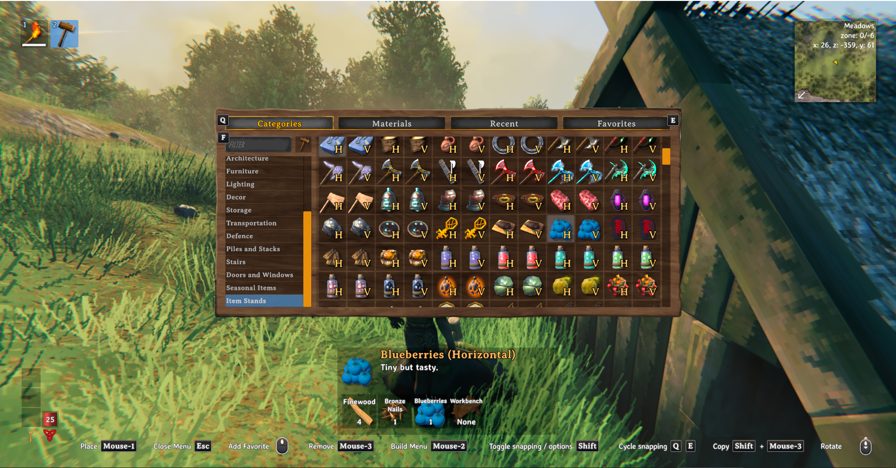
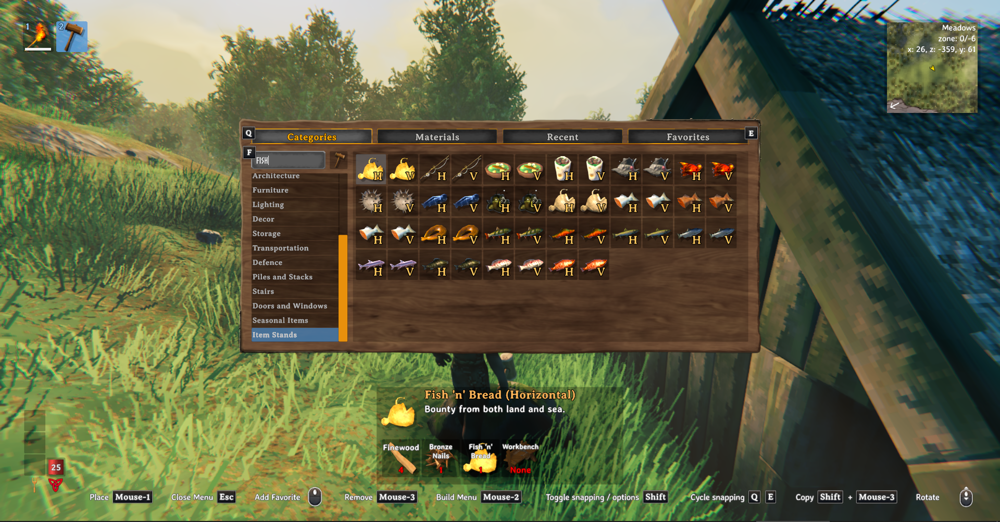
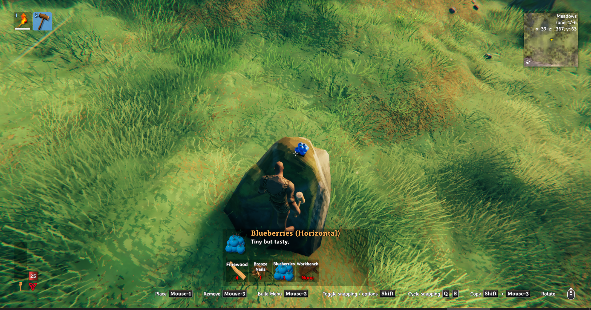

# Valerius Item Stand Menu

Adds a client-side visual catalogue to Valheim's Hammer for placing item stands with an item already attached.

## Functionality

**Automatic item discovery**

Compatible vanilla and modded items get automatically detected when Valheim launches, supporting most content and building mods. [Item Stand All Items by JereKuusela](https://thunderstore.io/c/valheim/p/JereKuusela/Item_Stand_All_Items/) is recommended for expanded item support.

**Menu location**

Find the pre-attached item stands by opening the Hammer's `Categories` tab and scrolling to `Item Stands` to access the catalogue, which has been optimized large item collections.

**Search**

Pre-attached item stands are excluded from regular Hammer searches. They can only be searched while the `Item Stands` side tab is open using the following combinable term types:

- Item names and Prefab names
- Item categories
- Mod names
- Orientation: `horizontal` or `vertical`

**Placement**

- Placed stands function normally, including item removal, replacement and dismantling.
- Horizontal stands show a temporary direction arrow while building to assist with orientation when an item lacks a placement preview.
- Recipes include the normal stand materials plus one of the selected item, with no materials consumed in no-cost building mode.

## Requirements & installation

**Mod managers**

Install through `Gale`, `r2modman` or `Thunderstore Mod Manager`. Required dependencies should be installed automatically.

**Manual installation**

1. Install [BepInExPack Valheim](https://thunderstore.io/c/valheim/p/denikson/BepInExPack_Valheim/) and [Jötunn](https://thunderstore.io/c/valheim/p/ValheimModding/Jotunn/).
2. Place `ValeriusItemStandMenu.dll` in `BepInEx/plugins/`.

[Manual installation guide](https://github.com/modcommunity/how-to-install-mods-in-valheim#installing-manually)

## Source code & issues

**Repository:** [SevDevonne/valheim-ItemStandMenu](https://github.com/SevDevonne/valheim-ItemStandMenu)

**Bug reports and suggestions:** [GitHub Issues](https://github.com/SevDevonne/valheim-ItemStandMenu/issues)

## Changelog

### 1.0.0

- Initial release.

## AI declaration

Artificial intelligence was used to assist in developing this mod⸻suggestions and generated code were reviewed and tested by a questionably competent human.